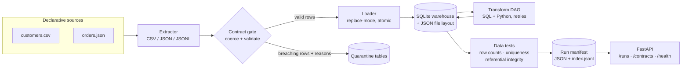

# ELT Data Contracts Platform

**Batch ELT with declarative data contracts — extract → contract gate (fail-closed, with quarantine) → warehouse load → DAG transforms → post-transform contracts and data tests → a manifest for every run.**

`topic: data-engineering` · Python 3.11+ · stdlib-first core (SQLite warehouse) · FastAPI service surface

All data is **synthetic** (invented customers and orders from a seeded
generator) and all code is original — a clean-room build with a generic
retail-style domain, suitable for studying the architecture without any
real-world system behind it.

---

## The enterprise problem

Batch pipelines fail in a predictable way: a producer changes a field,
a type, or a meaning, and the warehouse quietly absorbs it. Dashboards
go wrong *silently*, and the post-mortem discovers there was never an
agreement about what the data was supposed to look like. This platform
is built around fixing that, end to end:

1. **Contracts before code.** Every table has a declarative contract —
   columns, types, nullability, uniqueness, value constraints, and a
   freshness SLA — in YAML/JSON, owned and reviewable like code.
2. **Fail-closed, not fail-silent.** Rows that breach a contract are
   quarantined *with machine-readable reasons*; they never land as
   trusted data. A source that breaches wholesale fails the run.
3. **Transforms with a contract too.** Model outputs are validated
   against their own contracts, and cross-table data tests (uniqueness,
   referential integrity, row counts) gate run success.
4. **Re-runs must be safe.** Replace-mode loads and an idempotency-key
   ledger mean re-running a batch converges instead of duplicating.
5. **Every run is auditable.** A persisted manifest records steps, row
   counts in/out/quarantined, retries, and the full data-test report.

## Architecture



Full detail, decisions and failure-mode analysis: **[docs/architecture.md](docs/architecture.md)**.

## What it demonstrates

| Capability | Where |
|---|---|
| Declarative contracts (YAML/JSON): types, constraints, PKs, freshness SLAs | `contracts.py` |
| Contract validation at extract *and* after transform, with per-row reasons | `contracts.py`, `orchestrator.py` |
| Fail-closed quarantine tables (`<table>_quarantine`: payload + reasons) | `loader.py`, `orchestrator.py` |
| Declarative extraction for CSV / JSON / JSONL sources | `extractors.py` |
| Local warehouse: SQLite tables built from contracts + JSON file layout export | `loader.py` |
| Transform DAG: topological order, cycle detection, SQL + Python models, retries | `transforms.py` |
| Orchestration: staged run, idempotency keys, step accounting | `orchestrator.py` |
| Data tests: row counts, uniqueness, not-null, referential integrity, sums | `quality.py` |
| Run manifests persisted per run (JSON + append-only index) | `manifest.py` |
| Deterministic synthetic data, incl. a deliberately corrupt row | `generator.py` |
| FastAPI surface: pipeline runs + contract status | `api.py` |

## Quick start

```bash
pip install -r requirements.txt
pip install -e .

# Run the test suite
PYTHONPATH=src python -m pytest -q

# End-to-end offline demo: 20 synthetic customers, 60 orders
# (+ 1 deliberately corrupt order to exercise quarantine)
python examples/run_demo.py
# equivalently: elt-demo demo --clean
```

Sample report (abridged):

```json
{
  "run": {
    "pipeline": "retail-elt-demo", "status": "success",
    "total_loaded": 80, "total_quarantined": 1,
    "quality": {"passed": true, "checks": ["..."]}
  },
  "tables": {"customers": 20, "orders": 60, "orders_quarantine": 1,
             "orders_enriched": 60, "customer_summary": 20,
             "high_value_customers": 12}
}
```

Inspect what landed:

```bash
ls elt-demo-data/warehouse_files/          # one JSON file per table
cat elt-demo-data/manifests/index.jsonl    # one line per run
sqlite3 elt-demo-data/warehouse.db "select * from orders_quarantine;"
```

Run the service:

```bash
pip install -e ".[api]"
elt-demo serve --port 8000
curl localhost:8000/contracts
curl localhost:8000/runs
curl -X POST localhost:8000/runs/demo
```

Or with Docker: `docker build -t elt-data-contracts . && docker run -p 8000:8000 elt-data-contracts`

Contracts are also declared in [`examples/contracts.yml`](examples/contracts.yml)
(the same definitions the demo builds in code), and small sample sources
live in `examples/sample_data/` (`customers.csv`, `orders.json`).

## Design decisions & trade-offs

* **Per-row quarantine, whole-source failure.** Individual bad rows are
  quarantined and the good rows load — one corrupt record should not
  stall a business day. But a source with *zero* valid rows, a freshness
  breach, or a failing transform contract fails the run: at that point
  the producer is broken, not the data. *Trade-off:* thresholds are a
  policy choice; the manifest makes the counts impossible to miss.
* **Contracts own coercion.** CSV arrives as strings; the contract —
  not the extractor — declares the types, so coercion failures surface
  as contract breaches with reasons instead of silent `None`s.
* **Replace-mode loads + DROP/CREATE transforms.** Re-running a batch
  is the normal recovery move in ELT, so the platform makes it converge
  by construction; an idempotency key additionally short-circuits a
  duplicate *successful* run via the manifest ledger. *Trade-off:*
  history is kept in manifests and quarantine, not in table versions —
  a production system would add snapshots/SCD on top.
* **SQLite as the warehouse.** Same contract surface as a cloud
  warehouse (typed tables from contracts, SQL transforms, SQL tests),
  zero infrastructure. The loader isolates the dialect so DuckDB/
  Postgres/Snowflake is a loader project, not a rewrite.
* **JSON file layout instead of Parquet.** Human-inspectable and
  dependency-free; the layout (one self-describing file per table under
  the export root) mirrors a partitioned lake layout. Parquet is the
  production encoding, not a redesign.

## Repository layout

```
src/elt_platform/
  contracts.py    Contract model, YAML/JSON loading, coercion, validation, freshness
  extractors.py   Declarative CSV/JSON/JSONL source extraction
  loader.py       SQLite warehouse, contract-built tables, quarantine, JSON export
  transforms.py   SQL + Python transform models and the dependency DAG runner
  quality.py      Data tests: counts, uniqueness, referential integrity, sums
  manifest.py     Run manifests + file-backed store (the idempotency ledger)
  orchestrator.py Pipeline: extract -> gate -> load -> transform -> validate -> test
  generator.py    Deterministic synthetic sources (+ controlled corruption)
  demo.py         The demo pipeline definition and runner
  api.py          FastAPI surface: /health, /contracts, /runs, /runs/demo
  cli.py          elt-demo CLI (demo / contracts / serve)
tests/            pytest across contracts, extraction, transforms, quality, orchestration
docs/             Architecture deep-dive + CI template
examples/         run_demo.py, contracts.yml, sample_data/ (CSV + JSON sources)
```

## Roadmap

- [ ] Incremental (append + merge/upsert) load mode with watermark state
- [ ] Contract versioning and backward-compatibility checks in CI
- [ ] Parquet export and a DuckDB/Postgres warehouse backend
- [ ] Lineage graph emitted from the transform DAG + contract registry API
- [ ] Alerting hooks on quarantine-rate and freshness-SLA breaches

## License

MIT — see [LICENSE](LICENSE).
